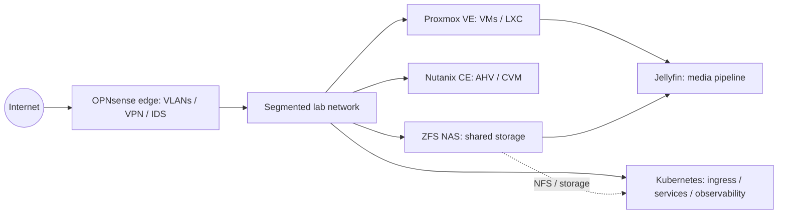

# Darian O'Dirling

**Enterprise Solutions Architecture | Hybrid Multicloud & HCI | Zero Trust Security | Cloud-Native Platforms**

Durham, North Carolina · Research Triangle Park (RTP) · [Architecture portfolio](https://darianodirling.github.io/) · [GitHub](https://github.com/darianodirling)

I work at the intersection of enterprise infrastructure, customer outcomes, security, and resilient platform design. My experience spans customer experience at **Nutanix**, data-center technical consulting at **Cisco**, and systems technical support at **SAS**. I focus on translating business requirements into architectures that are operationally supportable, secure by design, and measurable against recovery, availability, and cost objectives.

## Architectural pillars

| Pillar | What I design and evaluate |
| --- | --- |
| **Hybrid multicloud & HCI** | Nutanix AOS/AHV, Prism Central, VM protection, replication, disaster-recovery orchestration, placement, and lifecycle strategy. |
| **Zero Trust network security** | Identity- and context-driven access, segmentation, secure remote access, Cisco network/security platforms, and policy verification. |
| **Cloud-native Kubernetes** | Workload deployment, ingress, horizontal scaling, storage integration, metrics, observability, and operational runbooks. |
| **Self-hosted enterprise home lab** | Multi-hypervisor sandbox with OPNsense, Proxmox VE, Nutanix CE, Kubernetes, ZFS NAS, and Jellyfin for architecture experiments and repeatable validation. |

## Featured reference architectures

| Architecture | Focus | Repository |
| --- | --- | --- |
| **Nutanix hybrid multicloud DR blueprint** | AOS/AHV, Flow microsegmentation, recovery design, runbooks | [View completed architecture](https://github.com/darianodirling/nutanix-hybrid-multicloud-dr-blueprint) |
| **Cisco Zero Trust security fabric** | SSE/SASE, FTD/FMC, ASA, IOS, ISE, TrustSec | [View completed architecture](https://github.com/darianodirling/cisco-zero-trust-security-fabric) |
| **KCNA multi-node Minikube lab and observability** | Two-node Minikube, Calico, Kubernetes workloads, RBAC, storage, Helm, Prometheus/Grafana and ArgoCD | [View completed architecture](https://github.com/darianodirling/minikube-nginx-prometheus-observability) |
| **Enterprise home lab infrastructure** | OPNsense, Proxmox, Nutanix CE, Kubernetes, ZFS, Jellyfin | [View completed architecture](https://github.com/darianodirling/enterprise-homelab-infrastructure) |

> **Project status:** I have completed the four architecture projects listed above. Their repositories contain architecture documentation and reference configurations. The KCNA hands-on workbook is documented separately in the Kubernetes repository; its individual lab exercise verification is tracked there. Architecture completion does not imply a production deployment or vendor certification of the configurations.

## Enterprise home lab overview

My self-hosted R&D sandbox provides an environment to explore enterprise design tradeoffs without relying on customer production systems:

**Research themes:** tenant isolation; failure-domain boundaries; backup and restore validation; reproducible VM provisioning; persistent workloads; service exposure; telemetry; and workload lifecycle management. The lab is a **non-production learning environment**; platform-specific compatibility and actual deployment validation are documented per project.

## Credentials

*Credentials below are supplied by me and should be checked against issuer records/badges before being treated as independently verified.*

| Issuer | Credential |
| --- | --- |
| Nutanix | Nutanix Certified Master – Multicloud Infrastructure (NCM-MCI) |
| Nutanix | Nutanix Certified Professional – Multicloud Infrastructure (NCP-MCI) |
| Nutanix | Nutanix Certified Professional – Network Security (NCP-NS) |
| Cisco | Cisco Certified Specialist – Security Infrastructure Design |
| Cisco | Cisco Certified Network Associate (CCNA) |
| Cisco | Cisco Certified AI Technical Practitioner |
| CompTIA | CompTIA Security+ ce |
| Amazon Web Services | AWS Certified Cloud Practitioner (CLF-C02) |
| Microsoft | Microsoft Certified: Azure Fundamentals (AZ-900) |

*Issuer verification:* [Nutanix University](https://www.nutanix.com/support-services/training-certification) · [Cisco Certifications](https://www.cisco.com/site/us/en/learn/training-certifications/certifications/index.html) · [CompTIA Verification](https://www.certmetrics.com/comptia/public/verification.aspx) · [AWS Certification](https://aws.amazon.com/certification/) · [Microsoft Credentials](https://learn.microsoft.com/credentials/)

## Education & experience

- **M.S., Computer Science** — Georgia Institute of Technology
- **B.S., Computer Science** — East Carolina University
- **Customer Experience Manager** — Nutanix
- **Technical Consulting Engineer (Contractor)** — Cisco Systems
- **Systems Technical Support Engineer** — SAS
- **Data Center Technical Consulting Engineer Intern** — Cisco Systems

## Architecture review lens

I evaluate solutions through **business objectives → nonfunctional requirements → threat model → architecture options → operational model → validation evidence**. Typical artifacts include topology diagrams, decision records, segmentation matrices, failure-mode analysis, recovery checklists, and cost/risk considerations.

**Explore:** [Portfolio](https://darianodirling.github.io/) · [Reference architectures](https://github.com/darianodirling?tab=repositories)
